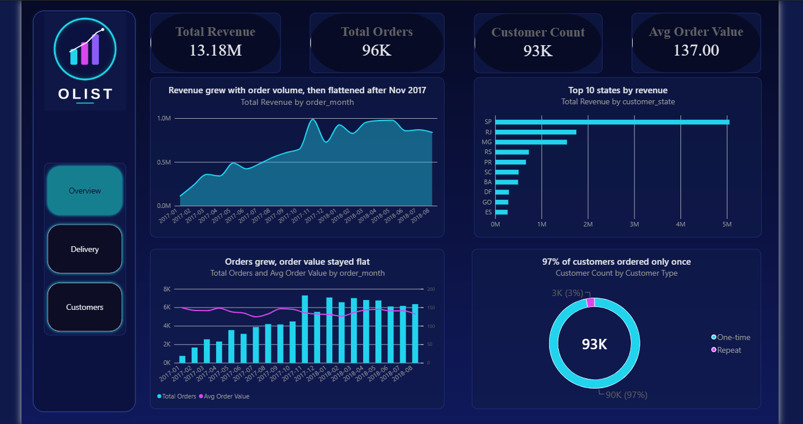
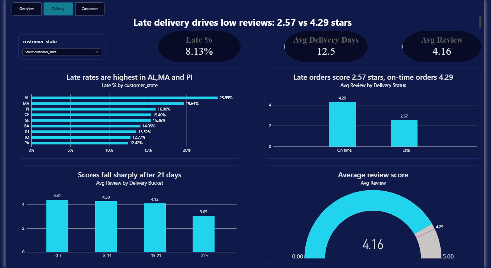
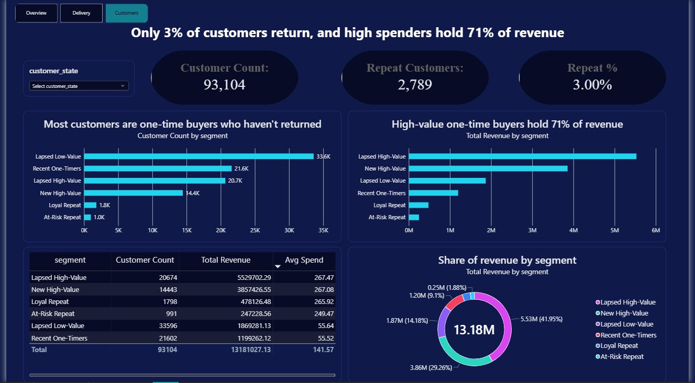

# E-Commerce Customer Retention & Delivery Performance Analytics

An end-to-end analytics project on the Olist Brazilian e-commerce dataset: SQL for the data model and analysis, Python for cleaning, segmentation, retention and hypothesis testing, and a three-page Power BI dashboard.

**Business questions**

1. Is the marketplace growing through repeat customers or through new ones?
2. How much does late delivery hurt customer satisfaction?
3. Which customers carry the revenue?

**Tools:** MySQL, Python (pandas, SQLAlchemy, matplotlib, seaborn, SciPy), Power BI. A Tableau version is planned as a later extension.

---

## Key findings

Analysis window: January 2017 to August 2018, delivered orders only. Revenue is item price without freight.

|Measure|Value|
|-|-|
|Revenue|13,181,027.13|
|Delivered orders|96,211|
|Customers|93,104|
|Average order value|137.00|

1. **Growth came from new customers, not repeat buyers.** 97% of customers (90,315 of 93,104) ordered only once. The 2,789 repeat customers (3.0%) hold 5.5% of revenue. On average only 0.48% of a monthly cohort orders again in the following month.
2. **Late delivery is linked to much lower satisfaction.** 8.13% of orders are late. Late orders average 2.57 stars against 4.29 for on-time orders, and 54.1% of late orders get 1 or 2 stars against 9.2% of on-time orders (Mann-Whitney U, p < 0.001, rank-biserial correlation -0.55). Scores fall to 3.05 for orders that take 22 days or more.
3. **A few customers carry the revenue.** High-spending one-time buyers are 37.7% of customers and hold 71.3% of revenue.
4. **Delivery performance is uneven.** The highest late rates are in AL (24.0%), MA (19.6%) and PI (16.0%). RJ matters most by volume, with 13.5% late across 12,310 orders. SP, RJ and MG together are 63.4% of revenue.

The late-delivery result is an association. Region, category and seller were not controlled for, so it does not prove cause.

**What the numbers suggest**

* Delivery reliability looks like the clearest lever, especially in the worst states and for orders likely to take 22 days or more.
* Because the data cannot show what would bring one-time buyers back, any retention idea (for example a follow-up for high-value first-time buyers) should be tested, not assumed.
* Repeat rate and the share of orders taking 22 days or more are sensible KPIs to track.

---

## Dashboard

The Power BI report has three pages, and every headline number reconciles to the SQL and Python results.

**Overview**



**Delivery**



**Customers**



The report file is `dashboards/olist_dashboard.pbix`. It loads three prepared tables (`vw_orders_master`, `vw_customer_summary`, `rfm_segments`) so revenue is never duplicated by joins.

---

## Project phases

|Phase|What was done|Where|
|-|-|-|
|1. Setup|Loaded 9 CSV files into MySQL and checked row counts|`sql/01_create_tables_and_load.sql`|
|2. Understand the data|Table grain, keys, missing values, duplicates, data dictionary|`sql/02_data_exploration.sql`, `reports/data_dictionary.md`|
|3. SQL analysis|Revenue, products, sellers, states, delivery, payments, plus three reconciled views|`sql/03_analysis.sql`, `sql/04_views.sql`|
|4. Cleaning and EDA|Checks against SQL, missing values, 11 charts, hidden-character fix|`notebooks/01_cleaning_eda.ipynb`, `sql/05_data_fixes.sql`|
|5. RFM segmentation|Six customer segments with quintile and fixed-rule scoring|`notebooks/02_rfm_segmentation.ipynb`|
|6. Cohort retention|Monthly cohorts, retention heatmap and average curve|`notebooks/03_cohort_retention.ipynb`|
|7. Hypothesis testing|Mann-Whitney U, effect sizes and confidence intervals|`notebooks/04_hypothesis_testing.ipynb`|
|8. Power BI dashboard|Three-page dashboard with a custom theme|`dashboards/`|
|9. Tableau dashboard|Planned for later|-|
|10. Documentation|Notes, data dictionary and this README|`notes.md`, `reports/`|

Full detail, including every decision and the problems I hit, is in [`notes.md`](notes.md).

---

## Method highlights

* **Customer identity:** `customer_unique_id`, because `customer_id` is generated per order (99,441 order-level IDs against 96,096 real customers).
* **Avoiding duplicated revenue:** `order_items`, `order_payments` and `order_reviews` are each aggregated to one row per order before joining. Joining them all at once inflated item revenue by about 4.5% in my check.
* **Analysis window:** January 2017 to August 2018, because the months outside it have too few orders and would create fake spikes and drops.
* **RFM:** about 97% of customers ordered once, so frequency uses fixed rules (1, 2, 3 or more) instead of quintiles, and one-time buyers are split by recency and spend.
* **Testing:** review scores are ordinal and skewed, so a rank-based test is used, with effect sizes and confidence intervals because the sample is large.
* **Reconciliation:** every view, notebook and dashboard total is checked against 13,181,027.13 revenue, 96,211 orders and 93,104 customers.

---

## Repository structure

```
olist-customer-analytics/
  dashboards/
    olist_dashboard.pbix
    olist_neon_theme.json
    assets/            background images and logo
    screenshots/       one image per page
  data/                raw and processed data (not tracked by Git)
  notebooks/           01 cleaning and EDA, 02 RFM, 03 cohorts, 04 hypothesis tests
  reports/
    data_dictionary.md
    figures/           saved charts
  sql/                 01 load, 02 exploration, 03 analysis, 04 views, 05 data fixes
  notes.md             project notes, decisions and results
  README.md
```

---

## How to run it

1. **Get the data.** Download the [Olist Brazilian E-Commerce dataset](https://www.kaggle.com/datasets/olistbr/brazilian-ecommerce) from Kaggle and place the CSV files in `data/raw/` (the data is not included in this repository).
2. **Build the database.** In MySQL Workbench, run `sql/01_create_tables_and_load.sql` after replacing the file path with your own, then run `02` to `05` in order. Check the row counts against `notes.md`.
3. **Install the Python packages:**
   ```
   pip install pandas numpy matplotlib seaborn scipy sqlalchemy pymysql jupyter
   ```
4. **Run the notebooks in order** (`01` to `04`). Each one asks for your MySQL password in a hidden prompt, so no password is stored in the notebook. In notebooks `02` to `04`, change the `PROJECT` path in the first code cell to your own project folder.
5. **Open the dashboard.** Open `dashboards/olist_dashboard.pbix` in Power BI Desktop. To refresh it, point the MySQL source at your own `olist_db`. The `rfm_segments` table is created by notebook `02`.

---

## Limitations

* The dashboard covers revenue, delivery, reviews, customers and RFM segments. Category, payment and seller analysis is in the SQL and Python phases, and cohort retention and the hypothesis tests are in the notebooks.
* "Lapsed" customers are those with no order in about six months or more inside a 20-month window, not confirmed churn.
* Customers who bought late in the window had little time to return, so the repeat rate may be slightly understated.
* The review findings use only orders that have a review (644 delivered orders have none).
* The dashboard uses imported data, so it does not update unless it is refreshed.

---

## Data source

Olist, [Brazilian E-Commerce Public Dataset by Olist](https://www.kaggle.com/datasets/olistbr/brazilian-ecommerce), Kaggle. Customer and seller IDs in the dataset are anonymised.
Dataset credit: Olist and André Sionek, via Kaggle. Licence: CC BY-NC-SA 4.0 (non-commercial use with attribution).

## Author

**Pavithra Menon M**
GitHub: [github.com/pavithra2602](https://github.com/pavithra2602)
LinkedIn: [linkedin.com/in/pavithra-menon-0095402b4](https://www.linkedin.com/in/pavithra-menon-0095402b4)
